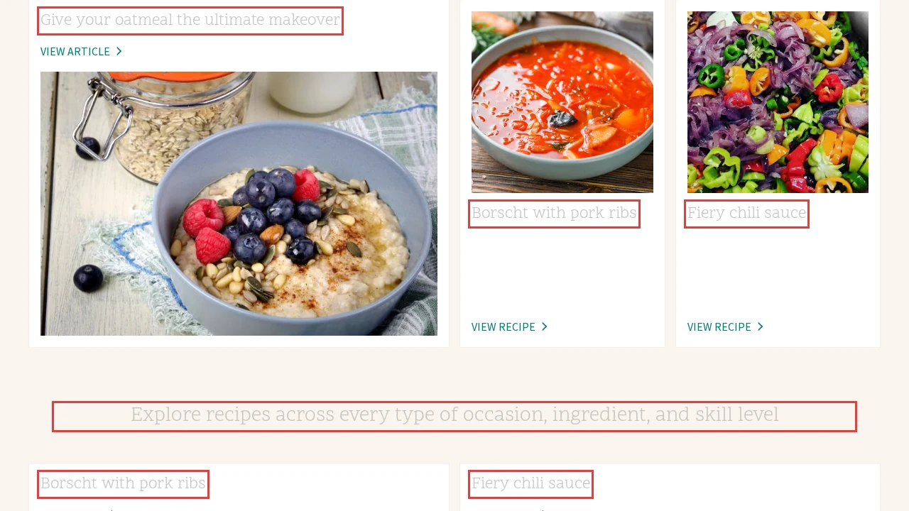
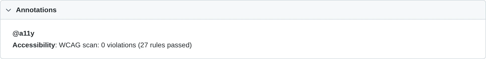
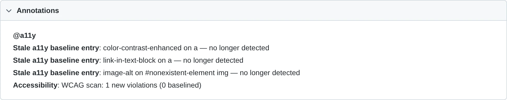
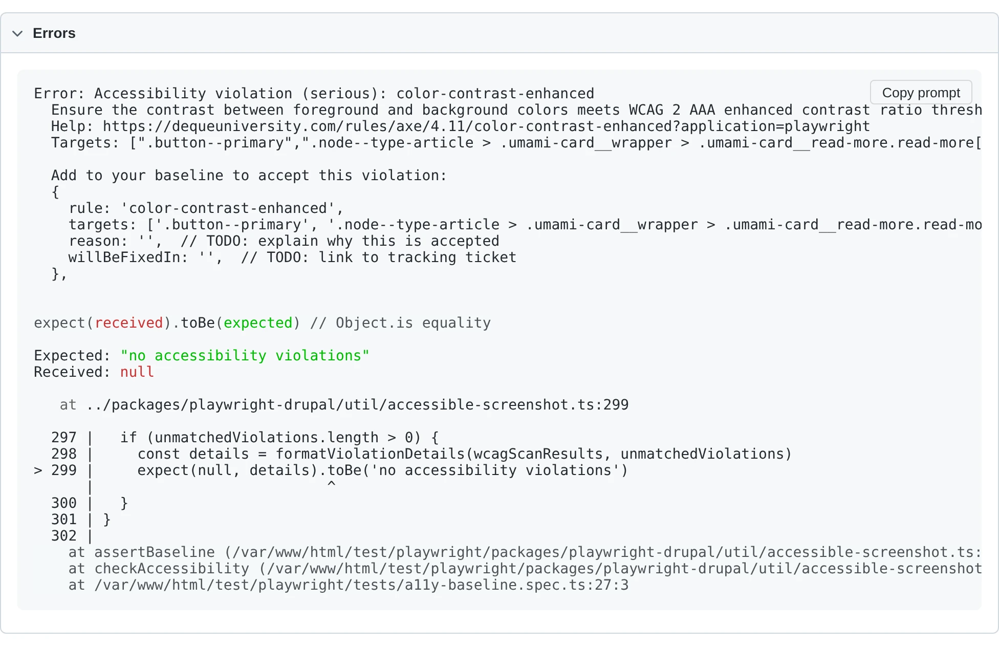
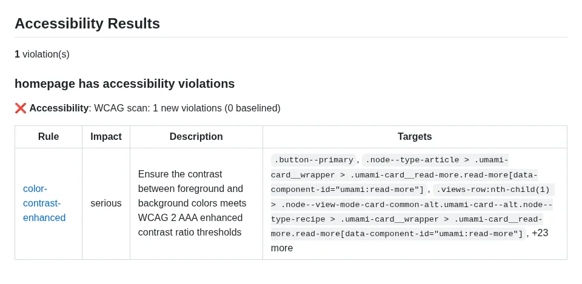

# Accessibility Tests in Drupal

The accessibility implementation is owned by
[`@lullabot/playwright-testing`](../generic-playwright-utilities/accessibility.md).
The Drupal package keeps the established imports and adds Drupal-specific
defaults through its adapter.

```typescript
import {
  checkAccessibility,
  takeAccessibleScreenshot,
  test,
} from '@packages/playwright-drupal';

test('home page accessibility', async ({ page }, testInfo) => {
  await page.goto('/');
  await checkAccessibility(page, testInfo);
});

test('home page screenshot and accessibility', async ({ page }, testInfo) => {
  await page.goto('/');
  await takeAccessibleScreenshot(page, testInfo);
});

test('home page via the fixture', async ({ page, a11y }) => {
  await page.goto('/');
  await a11y.check();
});
```

## Drupal preset

Calls through `@lullabot/playwright-drupal` apply the historical Drupal
behavior:

- known skip-link, landmark, footer, and media-preview selectors are excluded
  from the applicable axe scan;
- lazy images that initially error can be requested again, which accommodates
  Stage File Proxy;
- Drupal's fixed administration toolbar is allowed to settle after scrolling;
  and
- the legacy Firefox and Safari project-name thresholds remain in effect.

Caller options still win over preset defaults. Set
`accessibility.disableDefaultExclusions: true` on a screenshot, or
`disableDefaultExclusions: true` on `a11y.check()`, to scan Drupal's default
exclusions too.

```typescript
test('scan every element', async ({ page, a11y }) => {
  await page.goto('/');
  await a11y.check({ disableDefaultExclusions: true });
});
```

The `a11y` fixture is Drupal-package functionality. It exposes:

- `a11y.check(options)` as shorthand for
  `checkAccessibility(page, testInfo, options)`; and
- `a11y.screenshot(options, scrollLocator, locator)` as shorthand for
  `takeAccessibleScreenshot(page, testInfo, options, scrollLocator, locator)`.

## Baselines and reports

Baseline files, first-run seeding, accessibility annotations, violation
screenshots, shared in-code baselines, and scan options behave as documented in
the [canonical accessibility guide](../generic-playwright-utilities/accessibility.md).

When WCAG violations are found, the report attaches a full-page screenshot with
each violating element outlined in red:



A passing test shows the `@a11y` tag and a scan summary:



When a baseline is in use, the report also lists baselined violations and any
stale entries:



Unmatched violations fail the test with the rule, impact, help URL, affected
targets, and a baseline entry you can paste into `.a11y-baseline.json`:


The Drupal package re-exports `defineAccessibilityBaseline` and the associated
types, so existing code does not need to change.

```typescript
import {
  defineAccessibilityBaseline,
  test,
} from '@packages/playwright-drupal';

const baseline = defineAccessibilityBaseline([
  {
    rule: 'color-contrast',
    targets: ['#footer .legal'],
    reason: 'Waiting for the approved brand palette update.',
    willBeFixedIn: 'https://example.com/issues/123',
  },
]);

test('about page', async ({ page, a11y }) => {
  await page.goto('/about');
  await a11y.check({ baseline });
});
```

## Direct generic imports

Drupal projects can import a helper from `@lullabot/playwright-testing` when a
specific test must use neutral defaults. The generic call does not apply the
Drupal preset and does not provide the Drupal `a11y` fixture.

```typescript
import { test } from '@playwright/test';
import { checkAccessibility } from '@lullabot/playwright-testing';

test('neutral scan', async ({ page }, testInfo) => {
  await page.goto('/');
  await checkAccessibility(page, testInfo);
});
```

## GitHub annotations

The summary command renders the accessibility results into the GitHub job summary:



The legacy `playwright-drupal-a11y-summary` executable remains available and
uses the same report implementation as
`playwright-testing-a11y-summary`. Existing workflows can continue to use it:

```yaml
- name: Accessibility summary
  if: always()
  run: ddev exec npx playwright-drupal-a11y-summary --mode=summary

- name: Accessibility annotations
  if: always()
  run: ddev exec npx playwright-drupal-a11y-summary --mode=annotations
```

The JSON reporter configured by `definePlaywrightDrupalConfig()` provides the
input automatically. For command options, neutral library imports, and new
non-Drupal workflows, see the canonical
[GitHub reporting guide](../generic-playwright-utilities/github-reporting.md).
